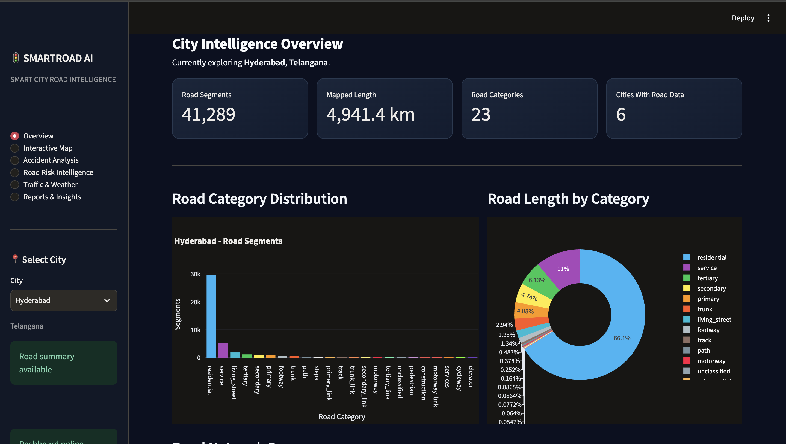
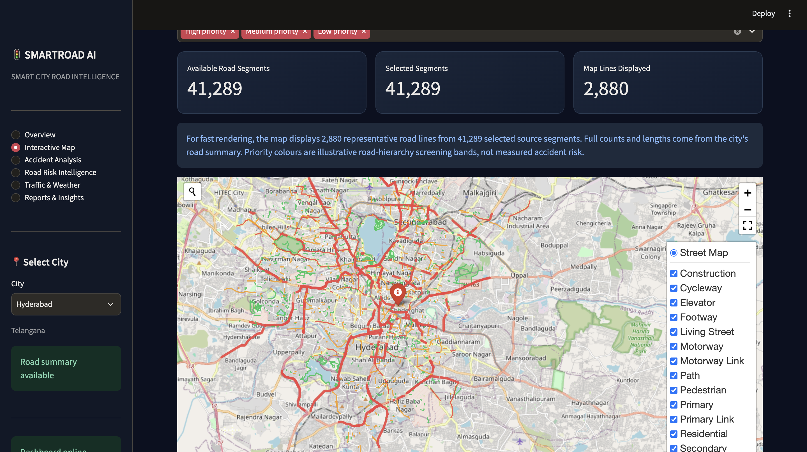
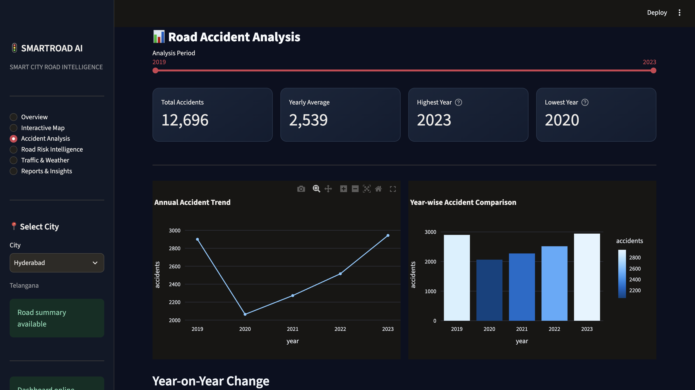
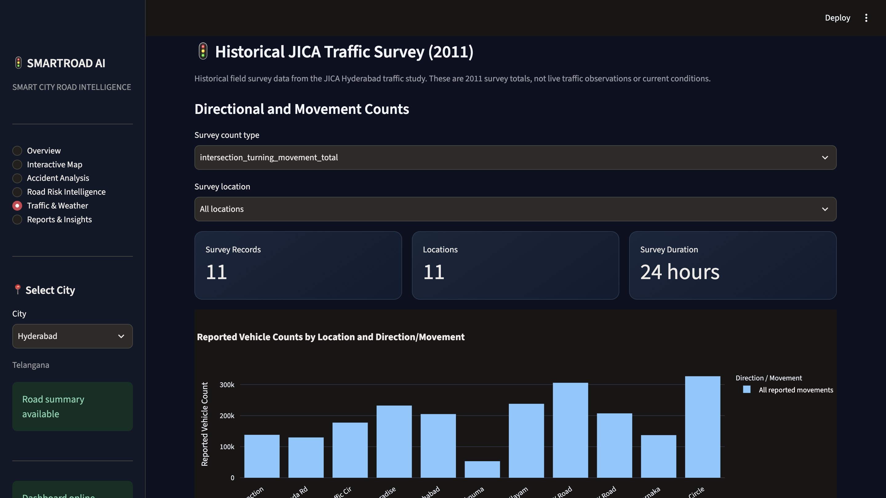
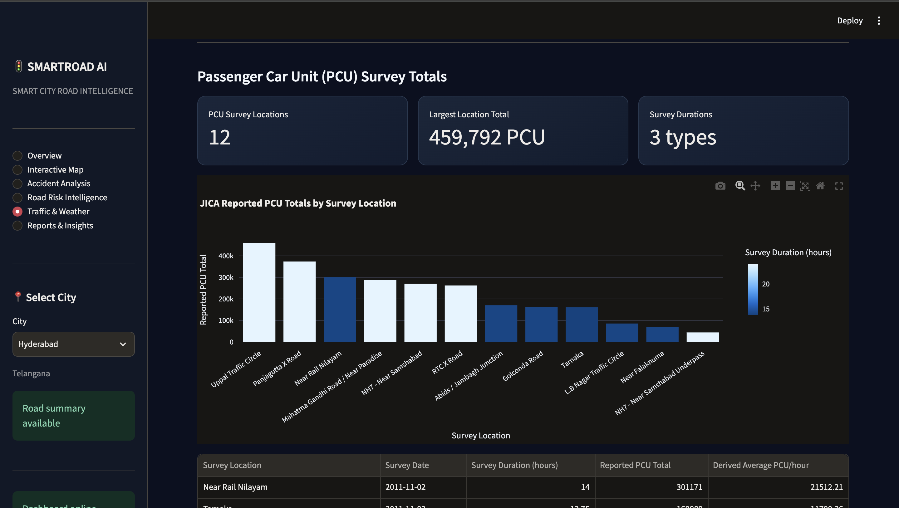
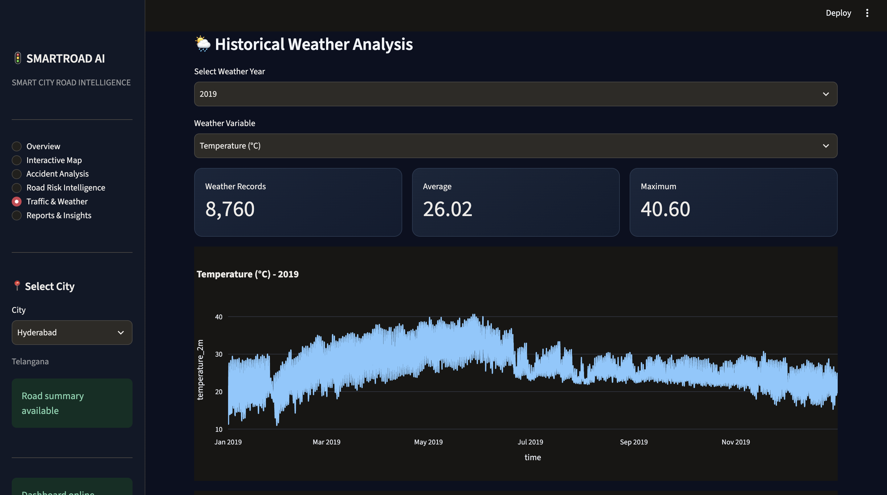
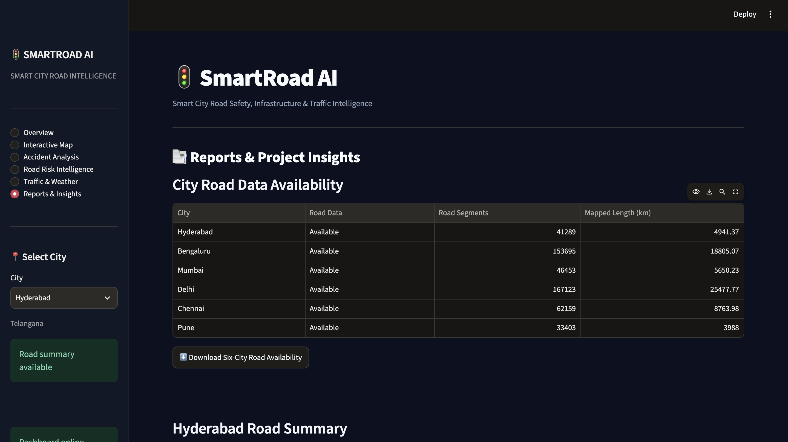

# 🚦 SmartRoad AI – Smart City Road Safety, Infrastructure & Traffic Intelligence

## 📌 Project Overview

SmartRoad AI is a Python-based interactive dashboard developed using Streamlit to analyse urban road networks, accident statistics, historical traffic survey data, and weather information.

The project aims to support smart city planning through interactive maps, data visualizations, road infrastructure analysis, and road safety insights.

The application covers road network data from six Indian cities:
- Hyderabad
- Bengaluru
- Mumbai
- Delhi
- Chennai
- Pune

Detailed accident, traffic, and weather analysis is currently focused on Hyderabad.

## 🎯 Problem Statement

Urban cities face increasing road safety challenges due to growing vehicle usage, expanding road networks, and changing traffic conditions.

Road infrastructure, accident statistics, traffic information, and weather data are often maintained separately. This makes it difficult to analyse these factors together.

SmartRoad AI addresses this problem by integrating available datasets into an interactive dashboard to support road safety analysis and urban infrastructure planning.

## 🎯 Project Objectives

- Analyse road infrastructure across multiple Indian cities.
- Visualize road networks using interactive maps.
- Study historical accident statistics.
- Analyse historical traffic survey information.
- Explore vehicle counts and Passenger Car Unit (PCU) data.
- Analyse historical weather information.
- Identify road categories requiring infrastructure screening attention.
- Provide downloadable analytical reports.

## ✨ Key Features

- Six-city road network visualization.
- Interactive maps with different map styles.
- Road category filtering.
- Road length and segment analysis.
- Hyderabad accident trend analysis.
- Road priority screening using illustrative weights.
- Historical traffic and PCU analysis.
- Historical weather analysis.
- Interactive charts and reports.
- CSV data downloads.

## 📊 Dashboard Modules

### 1. Overview
Displays total road segments, mapped road length, road categories, city coverage, and accident statistics where available.

### 2. Interactive Map
Displays road networks with interactive map layers, road categories, and filtering options.

### 3. Accident Analysis
Analyses annual accident statistics for Hyderabad from 2019 to 2023.

### 4. Road Risk Intelligence
Uses illustrative road-category weights to classify road segments into High, Medium, and Low screening priorities.

### 5. Traffic & Weather Analysis
Combines historical JICA traffic survey information, PCU data, and Open-Meteo historical weather data.

### 6. Reports & Insights
Provides downloadable datasets, road summaries, and analytical information.

## 📍 Accident Statistics – Hyderabad

| Year | Accidents |
|---|---:|
| 2019 | 2,900 |
| 2020 | 2,064 |
| 2021 | 2,273 |
| 2022 | 2,516 |
| 2023 | 2,943 |

These are annual city-level accident counts, not individual accident locations.

## 🌍 Dataset Sources

| Dataset | Source |
|---|---|
| Road network data | [OpenStreetMap](https://www.openstreetmap.org/) |
| Road network extracts | [BBBike Extract](https://extract.bbbike.org/) |
| Historical weather data | [Open-Meteo Archive](https://open-meteo.com/en/docs/historical-weather-api) |
| Hyderabad traffic survey | [JICA Traffic Survey Report](https://openjicareport.jica.go.jp/pdf/12150363_04.pdf) |
| Accident statistics | Hyderabad accident CSV used in this project |

**Dataset notes:**
- Road network information is obtained from OpenStreetMap.
- BBBike provides downloadable road network extracts.
- Weather information uses the Open-Meteo Historical Weather API.
- Traffic survey information is based on the JICA Hyderabad traffic survey report from 2011.
- The original publisher of the accident CSV must be verified separately before assigning source attribution.

## 🛠️ Technologies Used

- Python
- Streamlit
- Pandas
- GeoPandas
- Folium
- Plotly
- Shapely
- Streamlit-Folium
- ijson

## ⚙️ Installation and Setup

### Step 1: Clone the repository

```bash
git clone https://github.com/gollasricharan/SmartRoad-AI-Smart-City-Traffic-Analytics.git
```

### Step 2: Open the project folder

```bash
cd SmartRoad-AI-Smart-City-Traffic-Analytics
```

### Step 3: Create a virtual environment

```bash
python3 -m venv venv
```

### Step 4: Activate the environment

```bash
source venv/bin/activate
```

### Step 5: Install dependencies

```bash
pip install -r requirements.txt
```

### Step 6: Run the application

```bash
streamlit run SmartRoad_AI_Final_Updated.py
```

## 📁 Project Structure

```text
SmartRoad-AI/
│
├── SmartRoad_AI_Final_Updated.py
├── README.md
├── requirements.txt
├── .gitignore
│
├── data/
│   ├── raw/
│   └── processed/
│
├── scripts/
│
├── screenshots/
│
└── docs/
```

The actual folder structure may vary depending on the files included in the repository.

## 🗺️ Map and Data References

- OpenStreetMap: https://www.openstreetmap.org/
- BBBike Extract: https://extract.bbbike.org/
- Open-Meteo Historical Weather: https://open-meteo.com/en/docs/historical-weather-api
- JICA Hyderabad Traffic Survey: https://openjicareport.jica.go.jp/pdf/12150363_04.pdf

## ⚠️ Project Limitations

- Detailed accident, traffic, and weather analysis is currently Hyderabad-focused.
- JICA traffic survey data is historical (2011).
- Annual accident statistics are city-level counts, not geocoded accident locations.
- The road priority index is an illustrative screening method, not a validated accident probability.
- The project does not currently provide live traffic monitoring.
- The project does not currently contain a trained and validated accident prediction model.

## 🚀 Future Enhancements

- Real-time traffic data integration.
- Geocoded accident location analysis.
- Machine learning-based accident risk prediction using suitable validated datasets.
- Expansion of detailed analysis to more Indian cities.
- Improved road safety recommendations.
- Additional interactive visualizations.

## 👨‍💻 Project Information

**Project Name:** SmartRoad AI – Smart City Road Safety, Infrastructure & Traffic Intelligence

**Project Type:** MCA Academic Project

**Domain:** Data Analytics, Smart Cities, Road Safety and Geographic Information Systems (GIS)

**Developer:** Golla Sri Charan

## 📚 References

1. OpenStreetMap – https://www.openstreetmap.org/
2. BBBike – https://extract.bbbike.org/
3. Open-Meteo – https://open-meteo.com/
4. JICA Hyderabad Traffic Survey Report – https://openjicareport.jica.go.jp/pdf/12150363_04.pdf


## 🖼️ Application Screenshots

### 1. City Intelligence Overview
Displays road segments, mapped road length, road categories, and city coverage.



### 2. Interactive Road Network Map
Visualizes Hyderabad road infrastructure with interactive road categories and map filters.



### 3. Accident Analysis
Displays annual accident trends and year-wise accident comparisons from 2019 to 2023.



### 4. Road Risk Intelligence
Compares illustrative road-hierarchy screening indices across six cities.


### 5. Historical Traffic Survey
Explores historical JICA Hyderabad traffic survey counts and movement information.



### 6. Passenger Car Unit Analysis
Displays reported PCU totals and derived average PCU per hour.



### 7. Historical Weather Analysis
Visualizes historical weather variables and yearly trends.



### 8. Reports and Project Insights
Shows road data availability and downloadable project summaries.



---

⭐ If you find this project interesting, feel free to explore the repository and its documentation.